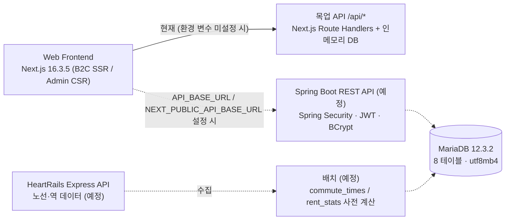
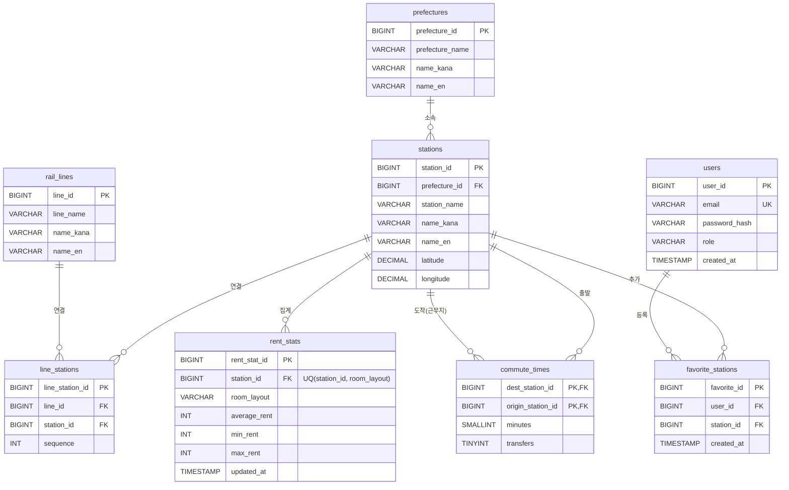

# 🚆 commute-rent-api — Commute Simulator Tokyo Backend API & Database

> 수도권(도쿄권) 이주자를 위한 월세·통근 시뮬레이터 백엔드 API · DB

[한국어](README.ko.md) | [日本語](README.md) · 프론트엔드: [commute-rent-web][frontend-repo]

> [!NOTE]
> 현재 상태: **DB 설계(MariaDB 12.3.2, 8개 테이블, DDL)와 API 명세(API-001〜017)는 완료**, **Spring Boot API는 예정(미구현)** 입니다.
> 그동안 프론트엔드는 같은 명세를 따르는 목업 API(Next.js Route Handlers, `/api/*`)로 동작합니다.
> 데이터: 노선·역은 **HeartRails Express API로 생성 예정**, 월세는 실데이터 확보가 어려워 **임시 생성 샘플 데이터**, 통근 시간은 현재 **거리 기반 근사값(샘플)** 입니다. → [6. 데이터 출처](#6-데이터-출처-data-sources)

상태 표기: ✅ 구현됨·완료 · 🟡 일부 구현 · 🔜 예정

---

## 1. 프로젝트 개요 (Project Overview)
- **개발 배경:** 일본의 복잡한 통근 경로와 월세 시세를 분석해, 최적의 거주지(역)를 제안하는 서비스입니다.
- **이 저장소의 역할:** 프론트엔드(B2C 검색·지도 / B2B 관리 콘솔)에 데이터를 제공하는 REST API와 DB 설계를 담당합니다.
- **핵심 검색:** 근무지 역 · 최대 월세 · 방 구조 · 최대 환승 횟수 · 최대 통근 시간 조건으로 역을 검색합니다. 통근 시간은 검색 시 계산하지 않고 **사전 계산 테이블**에서 조회합니다.

## 2. 기술 스택과 채택 이유 (Tech Stack & Why This Tech?)
| 계층 | 기술 | 상태 | 비고 |
|---|---|---|---|
| 데이터 수집 | **HeartRails Express API** (XML/JSON, GET) | 🔜 예정 | 노선·역 데이터 생성 배치에서만 사용 (런타임 호출 아님). 무료 이용 시 크레딧 표기 필요 |
| DB | **MariaDB 12.3.2** | ✅ 설계 완료 | InnoDB, utf8mb4 (`utf8mb4_uca1400_ai_ci`), 8개 테이블, CHECK 제약 사용 |
| API | **Spring Boot REST API** | 🔜 예정 | 목업 API와 같은 경로·파라미터·응답 형식을 따를 예정 |
| 인증 | **Spring Security + 서명된 JWT(HS256)**, **BCrypt** | 🔜 예정 | 토큰 유효기간 8시간, 비밀번호는 BCrypt 해시로 저장 |
| 페이징 | **Spring Data Pageable** | 🔜 예정 | `page`, `size`, `sort` 규약. 프론트엔드 관리 그리드는 이미 이 형식으로 구현 |
| 검토 중 | Java 17, Spring Data JPA, QueryDSL | 🔜 버전 미정 | Spring Data JPA는 비즈니스 로직에 집중하기 위해, QueryDSL은 노선·월세 조건의 다중 필터 검색을 타입 안전한 동적 쿼리로 작성하기 위해 검토 중 |
| 인프라 | AWS EC2 / AWS RDS (MariaDB) / AWS S3 + CloudFront | 🔜 초기 구상 | 배포 구성은 미정 |

## 3. 시스템 아키텍처 (System Architecture)
점선 = 예정(미구현)



## 4. ERD·데이터베이스 설계 (Database Design)



| 테이블 | 개요 | 주요 제약·인덱스 |
|---|---|---|
| `prefectures` | 도도부현 마스터 (JIS 코드 11〜14) | PK |
| `stations` | 역 마스터 (위도·경도) | `INDEX(latitude, longitude)` — 지도 bbox 검색 |
| `rail_lines` | 노선 마스터 | PK |
| `line_stations` | 노선–역 M:N 매핑, `sequence` = 노선 내 정차 순서 | `INDEX(line_id, station_id)` |
| `rent_stats` | 역 × 방 구조 단위 월세 통계 | `UNIQUE(station_id, room_layout)`, `INDEX(room_layout, average_rent)`, `CHECK(min ≤ avg ≤ max)` |
| `commute_times` | 근무지 역 × 전체 역의 소요 시간·환승 횟수 (사전 계산) | `PK(dest_station_id, origin_station_id)`, `INDEX(dest_station_id, minutes)` |
| `users` | 회원·관리자 계정 | `UNIQUE(email)` |
| `favorite_stations` | 회원별 즐겨찾기 역 (역을 직접 참조) | `UNIQUE(user_id, station_id)`, FK → `stations`, `users` (CASCADE) |

- **설계 포인트:** 일본 철도 특유의 복잡한 환승역 구조를 다루기 위해 `stations` 와 `rail_lines` 사이에 `line_stations` 라는 다대다(N:M) 매핑 테이블을 두어 정규화했습니다.
- 컬럼 상세: [테이블 정의서](docs/ko/CS-DB-001_테이블정의서_v1.0.xlsx) / DDL: [`docs/ko/schema.sql`](docs/ko/schema.sql)
- FK 삭제 규칙·DB명 `commute_sim`·콜레이션은 `schema.sql` 작성 시의 가정입니다.

## 5. 주요 설계 판단 (Key Design Decisions)

### 5.1 월세 통계는 '노선_역'이 아니라 '역' 단위로 정규화
- 초기안은 검색 속도를 중시해 월세를 `line_station_id` 에 연결했습니다. 하지만 신주쿠처럼 노선이 많은 역은 같은 월세가 노선 수만큼 중복 저장되고, 일부 행만 갱신되면 값이 어긋나며(갱신 이상), 검색 결과에 같은 역이 중복되어 `DISTINCT` 가 필요해졌습니다.
- 최종안은 `rent_stats.station_id` 로 정규화하고 `UNIQUE(station_id, room_layout)` 으로 **'역 1개 × 방 구조 1개 = 1행'** 을 보장합니다. 즐겨찾기·통근 시간과 조인 키(`station_id`)도 통일됩니다.
- 검색 속도는 인덱스로 확보합니다.
  - `rent_stats UNIQUE(station_id, room_layout)` — 역 기준 조인
  - `rent_stats INDEX(room_layout, average_rent)` — 방 구조(등치) + 월세 상한(범위) 검색용 **복합 인덱스(Composite Index)**. 등치 → 범위 순서
  - `line_stations INDEX(line_id, station_id)` — 노선으로 좁힌 역 ID를 인덱스만으로 조회
- 같은 `(station_id, room_layout)` 중복 등록은 **409 Conflict** 로 거부합니다 (목업 API에서 구현됨).

### 5.2 통근 시간은 검색 시 계산하지 않고 사전 계산
- 주요 근무지 역(약 20〜30개) × 전체 역의 소요 시간·환승 횟수를 배치로 미리 계산해 `commute_times` 에 저장합니다 (🔜 배치 예정, 목업 데이터는 거리 기반 근사값). 계산 방법은 [6. 데이터 출처](#6-데이터-출처-data-sources) 참고.
- 검색 시 경로 탐색 없이 `PK(dest_station_id, origin_station_id)`·`INDEX(dest_station_id, minutes)` 와 `rent_stats` 조인만으로 처리합니다.

```sql
-- 근무지 역까지 45분 이내·환승 1회 이하·1K 평균 월세 9만 엔 이하
SELECT s.station_id, s.station_name, s.latitude, s.longitude,
       c.minutes, c.transfers, r.average_rent, r.min_rent, r.max_rent
FROM   commute_times c
JOIN   stations   s ON s.station_id = c.origin_station_id
JOIN   rent_stats r ON r.station_id = c.origin_station_id
                   AND r.room_layout = :layout
WHERE  c.dest_station_id = :work_station_id
  AND  c.minutes      <= :max_minutes
  AND  c.transfers    <= :max_transfers
  AND  r.average_rent <= :max_rent
ORDER  BY c.minutes, r.average_rent;
```

### 5.3 노선 테이블명은 `rail_lines`
- `LINES` 는 MariaDB 예약어이므로 충돌을 피하기 위해 테이블명을 `rail_lines` 로 했습니다.

### 5.4 즐겨찾기는 역을 직접 참조
- `favorite_stations.station_id → stations` 로 직접 참조하고 `UNIQUE(user_id, station_id)` 로 중복을 막습니다. 마이페이지에서 위도·경도를 1단 조인으로 얻을 수 있습니다.

## 6. 데이터 출처 (Data Sources)

| 데이터 | 출처·생성 방법 | 상태 |
|---|---|---|
| 노선·역 (`rail_lines`, `stations`, `line_stations`) | **HeartRails Express API** 로 생성. `getLines`(지역·도도부현별 노선명), `getStations`(노선별 역: 역명, 도도부현, 경도 `x`·위도 `y`, 우편번호, 앞뒤 역 `prev`/`next`)를 배치에서 호출 → `line_stations.sequence` 는 앞뒤 역 관계로 정렬 | 🔜 예정 |
| 도도부현 (`prefectures`) | JIS 코드 11〜14 고정 데이터 (`schema.sql` 초기 INSERT), HeartRails `getPrefectures` 의 이름과 매핑 | ✅ (DDL) |
| 월세 (`rent_stats`) | 실데이터 확보가 어려워 **임시 생성 샘플 데이터** 사용. 현재 목업은 역별 1K 기준 월세 × 방 구조 계수를 500엔 단위로 반올림, 최소·최대는 평균의 72%·145% | 🟡 샘플 |
| 통근 시간 (`commute_times`) | 현재 목업은 거리 기반 근사값. 계획: ① HeartRails 역 순서·좌표로 만든 자체 그래프 + 다익스트라 **추정치** → ② OpenTripPlanner·r5py + ODPT GTFS(라이선스상 사용 가능한 노선)로 시각표 기반 보정 | 🔜 예정 |

- **HeartRails Express**: API는 상업·비상업 구분 없이 무료이며, 무료로 이용할 때는 애플리케이션 안에 「HeartRails Express」 크레딧을 표기해야 합니다. 이용 조건은 HeartRails 이용 약관·면책 사항을 따릅니다.
  - API 문서: https://express.heartrails.com/api.html · 이용 약관: https://www.heartrails.com/company/terms.html
  - 약관상 서버에 높은 부하를 주는 행위와 취득 정보의 전재·복사가 금지되어 있으므로, 수집 배치는 요청 간격을 두고 **원본 응답 덤프는 공개 저장소에 커밋하지 않습니다** (수집 스크립트만 공개).
  - 무료 API에는 역명 가나·로마자 표기가 없으므로 `name_kana`·`name_en` 은 NULL 허용 컬럼으로 둡니다.
- **통근 시간 API 검토 결과**: 구글은 일본 대중교통 경로를 API로 제공하지 않고, NAVITIME·駅すぱあと 등 상용 API는 결과 저장을 금지하거나 제한해 사전 계산 방식과 맞지 않습니다. 비교와 출처는 [통근 시간 API 조사](docs/commute_api_research_ko.md)를 참고하세요.

## 7. API 개요 (API Overview)
**공통 사양**
- Base URL: (본 구현·예정) 예) `http://localhost:8080/api` / (현재 목업) `http://localhost:3000/api`
- 요청·응답 `application/json; charset=UTF-8`, JSON은 snake_case(DB 컬럼명 기준), 쿼리 파라미터는 camelCase
- 인증: `Authorization: Bearer <JWT>` / 오류: `{"message": "…"}`
- 페이징 (Spring Data Pageable 호환): `?page=0&size=10&sort=field,asc&q=…` → `{content, totalElements, totalPages, number, size}`
- 상태 코드: 200 / 201 / 204 / 400 (입력 검증) / 401 (인증 실패) / 404 / 409 (UNIQUE 위반)

| ID | 메서드 | 경로 | 설명 | 인증 (본 구현) | 상태 |
|---|---|---|---|---|---|
| API-001 | GET | `/api/workplaces` | 근무지 역 목록 | – | ✅ 목업 |
| API-002 | GET | `/api/search` | 역 검색 (월세 × 통근) | – | ✅ 목업 |
| API-003 | GET | `/api/prefectures` | 도도부현 목록 | – | ✅ 목업 |
| API-004 | POST | `/api/auth/signup` | 회원가입 | – | ✅ 목업 |
| API-005 | POST | `/api/auth/login` | 로그인 (회원·관리자) | – | ✅ 목업 |
| API-006 | GET | `/api/favorites` | 즐겨찾기 목록 | USER | 🟡 |
| API-007 | POST | `/api/favorites` | 즐겨찾기 토글 | USER | 🟡 |
| API-008 | DELETE | `/api/favorites/{stationId}` | 즐겨찾기 삭제 | USER | 🔜 |
| API-009〜012 | GET / POST / PUT / DELETE | `/api/stations`, `/api/stations/{id}` | 역 목록(페이징)·등록·수정·삭제 | ADMIN | ✅ 목업 |
| API-013〜016 | GET / POST / PUT / DELETE | `/api/rent-stats`, `/api/rent-stats/{id}` | 월세 통계 목록(페이징)·등록·수정·삭제 (중복 409) | ADMIN | ✅ 목업 |
| API-017 | GET | `/api/admin/kpi` | 대시보드 KPI | ADMIN | ✅ 목업 |

"✅ 목업" = 프론트엔드 저장소의 목업 API로 동작 확인. Spring Boot 구현은 전부 🔜 예정입니다. 상세: [API 명세서](docs/ko/CS-API-001_API명세서_v1.0.xlsx)

## 8. 디렉터리 구조 (Directory Structure)
```text
commute-rent-api/
├── docs/
│   ├── ko/        # 설계 문서 (한국어) + schema.sql
│   ├── ja/        # 설계 문서 (일본어) + schema.sql
│   └── commute_api_research_ko.md   # 통근 시간 API 조사
└── (예정) Spring Boot 프로젝트 (build.gradle, src/main/java …, 데이터 수집 배치)
```

## 9. 로컬 환경 실행 방법 (Getting Started)
로컬 DB 환경 구축과 API 서버 실행 절차입니다.

```bash
# 0. 저장소 클론
git clone https://github.com/OWNER/commute-rent-api.git
cd commute-rent-api

# 1. MariaDB Docker 컨테이너 실행
docker run -d --name commute-db -p 3306:3306 \
  -e MYSQL_ROOT_PASSWORD=yourpassword \
  -e TZ=Asia/Seoul \
  -v mariadb_data:/var/lib/mysql \
  mariadb:12.3.2

# 2. 스키마 생성 (DB commute_sim + 8개 테이블 + 도도부현 초기 데이터)
docker exec -i commute-db mariadb -uroot -pyourpassword < docs/ko/schema.sql

# 3. Spring Boot 빌드·실행 (🔜 예정 — 구현 후 확정)
# ./gradlew build
# java -jar build/libs/commute-rent-api-0.0.1-SNAPSHOT.jar
```

## 10. 설계 문서 (Documents)
| 문서 ID | 문서 | 한국어 | 日本語 |
|---|---|---|---|
| CS-RD-001 | 요구사항 정의서 | [docx](docs/ko/CS-RD-001_요구사항정의서_v1.0.docx) | [docx](docs/ja/CS-RD-001_要件定義書_v1.0.docx) |
| CS-SD-001 | 화면설계서 | [xlsx](docs/ko/CS-SD-001_화면설계서_v1.0.xlsx) | [xlsx](docs/ja/CS-SD-001_画面設計書_v1.0.xlsx) |
| CS-API-001 | API 명세서 | [xlsx](docs/ko/CS-API-001_API명세서_v1.0.xlsx) | [xlsx](docs/ja/CS-API-001_API仕様書_v1.0.xlsx) |
| CS-DB-001 | 테이블 정의서 + DDL | [xlsx](docs/ko/CS-DB-001_테이블정의서_v1.0.xlsx) · [sql](docs/ko/schema.sql) | [xlsx](docs/ja/CS-DB-001_テーブル定義書_v1.0.xlsx) · [sql](docs/ja/schema.sql) |
| CS-TS-001 | 테스트 케이스 | [xlsx](docs/ko/CS-TS-001_테스트케이스_v1.0.xlsx) | [xlsx](docs/ja/CS-TS-001_テスト仕様書_v1.0.xlsx) |
| – | 통근 시간 API 조사 | [md](docs/commute_api_research_ko.md) | – |

## 11. 로드맵 (Roadmap)
- [x] DB 설계 (개념·논리·물리 모델, MariaDB 12.3.2 DDL)
- [x] API 명세 (API-001〜017) — 프론트엔드 목업 API로 검증
- [ ] 🔜 Spring Boot REST API 구현 (목업과 같은 경로·형식)
- [ ] 🔜 Spring Security + 서명된 JWT, BCrypt 해시 저장, email 중복 409
- [ ] 🔜 관리 API 서버 측 ADMIN 인가 (`/stations`, `/rent-stats`, `/admin/kpi` 목록 포함)
- [ ] 🔜 즐겨찾기 로그인 필수화 (JWT `sub` → `user_id`), 즐겨찾기 삭제 API (API-008)
- [ ] 🔜 Bean Validation + DB 제약 오류를 400/409로 변환
- [ ] 🔜 HeartRails Express로 노선·역 데이터 수집 배치 (크레딧 표기, 원본 덤프는 저장소에 커밋하지 않음)
- [ ] 🔜 통근 시간 사전 계산 배치 — 1단계: 자체 그래프 + 다익스트라(추정치) / 2단계: OpenTripPlanner·r5py + ODPT GTFS(커버 노선)
- [ ] 🔜 월세 샘플 데이터 생성 배치 (실데이터 출처를 확보하면 교체)
- [ ] 🔜 프론트엔드 타입과의 차이 해소 (역명 한국어 표기 `name_ko`, 노선 색상 `color` 등)
- [ ] 🔜 트러블슈팅·성능 개선 기록 (구현 후 실측 결과와 함께 작성)
- [ ] 🔜 배포 (초기 구상: AWS EC2 / RDS / S3 + CloudFront)

---
※ 월세는 임시 생성 샘플 데이터, 통근 시간은 샘플(추정) 데이터입니다. 노선·역 데이터: HeartRails Express (예정). © Kim GwangJin

<!-- OWNER 를 GitHub 사용자명으로 바꾸세요 (기본 브랜치 main 가정). -->
[frontend-repo]: https://github.com/OWNER/commute-rent-web/blob/main/README.ko.md
