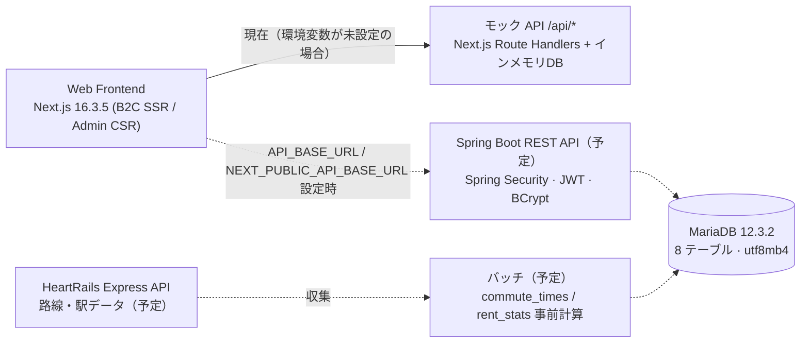
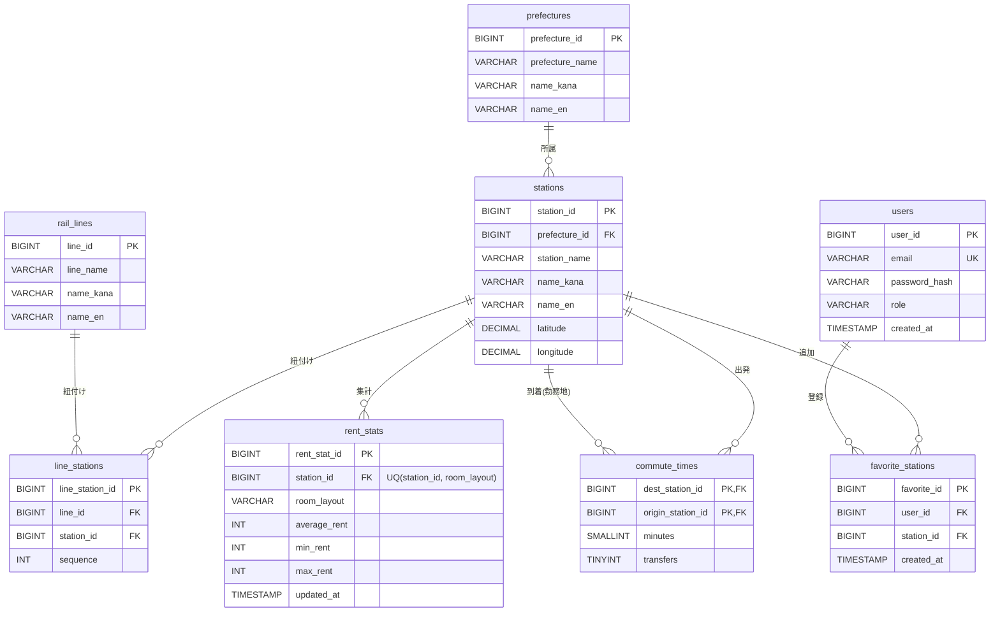

# 🚆 commute-rent-api — Commute Simulator Tokyo Backend API & Database

> 首都圏移住者のための家賃・通勤シミュレーター Backend API・DB

[한국어](README.ko.md) | [日本語](README.md) · フロントエンド: [commute-rent-web][frontend-repo]

> [!NOTE]
> 現在の状態: **DB 設計（MariaDB 12.3.2、8 テーブル、DDL）と API 仕様（API-001〜017）は完了**、**Spring Boot API は予定（未実装）** です。
> それまでフロントエンドは同じ仕様に沿ったモック API（Next.js Route Handlers、`/api/*`）で動作します。
> データ: 路線・駅は **HeartRails Express API で生成予定**、家賃は実データの入手が難しいため **一時的に生成したサンプルデータ**、通勤時間は現在 **距離ベースの近似値（サンプル）** です。→ [6. データ出典](#6-データ出典-data-sources)

状態: ✅ 実装済み・完了 · 🟡 一部実装 · 🔜 予定

---

## 1. プロジェクト概要 (Project Overview)
- **開発背景:** 日本の複雑な通勤経路と家賃相場を分析し、最適な居住地（駅）を提案するサービスです。
- **このリポジトリの役割:** フロントエンド（B2C 検索・地図 / B2B 管理コンソール）にデータを提供する REST API と DB 設計を担当します。
- **コア検索:** 勤務地の駅・家賃上限・間取り・乗換回数・通勤時間の上限で駅を検索します。通勤時間は検索時に計算せず、**事前計算テーブル** から取得します。

## 2. 技術スタックと採用理由 (Tech Stack & Why This Tech?)
| レイヤー | 技術 | 状態 | 備考 |
|---|---|---|---|
| データ収集 | **HeartRails Express API** (XML/JSON、GET) | 🔜 予定 | 路線・駅データを生成するバッチでのみ使用（実行時の呼び出しではない）。無料利用時はクレジット表記が必要 |
| DB | **MariaDB 12.3.2** | ✅ 設計済み | InnoDB、utf8mb4 (`utf8mb4_uca1400_ai_ci`)、8 テーブル、CHECK 制約を使用 |
| API | **Spring Boot REST API** | 🔜 予定 | モック API と同じパス・パラメータ・レスポンス形式に従う予定 |
| 認証 | **Spring Security + 署名付き JWT (HS256)**、**BCrypt** | 🔜 予定 | トークン有効期限 8 時間、パスワードは BCrypt ハッシュで保存 |
| ページング | **Spring Data Pageable** | 🔜 予定 | `page`, `size`, `sort` の規約。フロントエンドの管理グリッドは既にこの形式で実装済み |
| 検討中 | Java 17、Spring Data JPA、QueryDSL | 🔜 バージョン未定 | Spring Data JPA はビジネスロジックに集中するため、QueryDSL は路線・家賃データの多重フィルタリング検索を型安全な動的クエリで記述するために検討中 |
| インフラ | AWS EC2 / AWS RDS (MariaDB) / AWS S3 + CloudFront | 🔜 初期構想 | デプロイ構成は未定 |

## 3. システムアーキテクチャ (System Architecture)
点線 = 予定（未実装）



## 4. ERD・データベース設計 (Database Design)



| テーブル | 概要 | 主な制約・インデックス |
|---|---|---|
| `prefectures` | 都道府県マスタ（JIS コード 11〜14） | PK |
| `stations` | 駅マスタ（緯度・経度） | `INDEX(latitude, longitude)` — 地図の表示範囲 (bbox) 検索 |
| `rail_lines` | 路線マスタ | PK |
| `line_stations` | 路線–駅の多対多マッピング、`sequence` = 路線内の停車順 | `INDEX(line_id, station_id)` |
| `rent_stats` | 駅 × 間取り単位の家賃統計 | `UNIQUE(station_id, room_layout)`、`INDEX(room_layout, average_rent)`、`CHECK(min ≤ avg ≤ max)` |
| `commute_times` | 勤務地の駅 × 全駅の所要時間・乗換回数（事前計算） | `PK(dest_station_id, origin_station_id)`、`INDEX(dest_station_id, minutes)` |
| `users` | 会員・管理者アカウント | `UNIQUE(email)` |
| `favorite_stations` | 会員ごとのお気に入り駅（駅を直接参照） | `UNIQUE(user_id, station_id)`、FK → `stations`, `users` (CASCADE) |

- **設計ポイント:** 日本の鉄道特有の複雑な乗り換え駅構造を解決するため、`stations` と `rail_lines` テーブルの間に `line_stations` という多対多 (N:M) のマッピングテーブルを配置し、正規化しました。
- カラム詳細: [テーブル定義書](docs/ja/CS-DB-001_テーブル定義書_v1.0.xlsx) / DDL: [`docs/ja/schema.sql`](docs/ja/schema.sql)
- FK の削除ルール・DB 名 `commute_sim`・照合順序は `schema.sql` 作成時の仮定です。

## 5. 主な設計判断 (Key Design Decisions)

### 5.1 家賃統計は「路線_駅」ではなく「駅」単位に正規化
- 初期案では検索速度を重視し、家賃を `line_station_id` に紐付けていました。しかし新宿のように路線が多い駅では同じ家賃が路線の数だけ重複して保存され、一部の行だけ更新されると値が食い違い（更新時異状）、検索結果に同じ駅が重複して `DISTINCT` が必要になりました。
- 最終案では `rent_stats.station_id` に正規化し、`UNIQUE(station_id, room_layout)` で **「1駅 × 1間取り = 1行」** を保証します。お気に入り・通勤時間と結合キー (`station_id`) も統一されます。
- 検索速度はインデックスで確保します。
  - `rent_stats UNIQUE(station_id, room_layout)` — 駅を起点とした結合
  - `rent_stats INDEX(room_layout, average_rent)` — 間取り（等価）+ 家賃上限（範囲）検索用の **複合インデックス (Composite Index)**。等価 → 範囲の順
  - `line_stations INDEX(line_id, station_id)` — 路線で絞り込んだ駅 ID をインデックスのみで取得
- 同じ `(station_id, room_layout)` の重複登録は **409 Conflict** で拒否します（モック API で実装済み）。

### 5.2 通勤時間は検索時に計算せず、事前計算
- 主要な勤務地の駅（約 20〜30 駅）× 全駅の所要時間・乗換回数をバッチで事前に計算し、`commute_times` に保存します（🔜 バッチは予定、モックデータは距離ベースの近似値）。計算方法は [6. データ出典](#6-データ出典-data-sources) を参照。
- 検索時は経路探索を行わず、`PK(dest_station_id, origin_station_id)`・`INDEX(dest_station_id, minutes)` と `rent_stats` の結合だけで処理します。

```sql
-- 勤務地の駅まで45分以内・乗換1回以下・1K 平均家賃9万円以下
SELECT s.station_id, s.station_name, s.latitude, s.longitude,
       c.minutes, c.transfers, r.average_rent, r.min_rent, r.max_rent
FROM   commute_times c
JOIN   stations   s ON s.station_id = c.origin_station_id
JOIN   rent_stats r ON r.station_id = c.origin_station_id
                   AND r.room_layout = :layout
WHERE  c.dest_station_id = :work_station_id
  AND  c.minutes      <= :max_minutes
  AND  c.transfers    <= :max_transfers
  AND  r.average_rent <= :max_rent
ORDER  BY c.minutes, r.average_rent;
```

### 5.3 路線テーブル名は `rail_lines`
- `LINES` は MariaDB の予約語であるため、衝突を避けるためにテーブル名を `rail_lines` としました。

### 5.4 お気に入りは駅を直接参照
- `favorite_stations.station_id → stations` を直接参照し、`UNIQUE(user_id, station_id)` で重複を防ぎます。マイページでは緯度・経度を 1 段の結合で取得できます。

## 6. データ出典 (Data Sources)

| データ | 出典・生成方法 | 状態 |
|---|---|---|
| 路線・駅 (`rail_lines`, `stations`, `line_stations`) | **HeartRails Express API** で生成。`getLines`（エリア・都道府県別の路線名）、`getStations`（路線別の駅: 駅名、都道府県、経度 `x`・緯度 `y`、郵便番号、前後の駅 `prev`/`next`）をバッチで呼び出し、`line_stations.sequence` は前後の駅の関係から整列 | 🔜 予定 |
| 都道府県 (`prefectures`) | JIS コード 11〜14 の固定データ（`schema.sql` の初期 INSERT）、HeartRails `getPrefectures` の名称と対応付け | ✅ (DDL) |
| 家賃 (`rent_stats`) | 実データの入手が難しいため、**一時的に生成したサンプルデータ** を使用。現在のモックは駅ごとの 1K 基準家賃 × 間取り係数を 500 円単位で丸め、最小・最大は平均の 72%・145% | 🟡 サンプル |
| 通勤時間 (`commute_times`) | 現在のモックは距離ベースの近似値。計画: ① HeartRails の駅順・座標から作る独自グラフ + ダイクストラ法による **推定値** → ② OpenTripPlanner・r5py + ODPT の GTFS（ライセンス上利用できる路線）で時刻表ベースに補正 | 🔜 予定 |

- **HeartRails Express**: API は商用・非商用を問わず無料で、無料で利用する場合はアプリケーション内に「HeartRails Express」のクレジットを記載する必要があります。利用条件は HeartRails の利用規約・免責事項に従います。
  - API ドキュメント: https://express.heartrails.com/api.html · 利用規約: https://www.heartrails.com/company/terms.html
  - 規約上、サーバーへの高負荷を伴う行為や取得情報の転載・コピーが禁止されているため、収集バッチはリクエスト間隔を空け、**元のレスポンスのダンプは公開リポジトリにコミットしません**（収集スクリプトのみ公開）。
  - 無料 API には駅名のかな・ローマ字表記がないため、`name_kana`・`name_en` は NULL 許容カラムとします。
- **通勤時間 API の検討結果**: Google は日本の公共交通の経路を API で提供しておらず、NAVITIME・駅すぱあと等の商用 API は結果の保存を禁止・制限しているため、事前計算方式に合いません。比較と出典は [通勤時間 API 調査（韓国語）](docs/commute_api_research_ko.md) を参照してください。

## 7. API 概要 (API Overview)
**共通仕様**
- Base URL:（本実装・予定）例) `http://localhost:8080/api` /（現在のモック）`http://localhost:3000/api`
- リクエスト・レスポンスは `application/json; charset=UTF-8`、JSON は snake_case（DB カラム名基準）、クエリパラメータは camelCase
- 認証: `Authorization: Bearer <JWT>` / エラー: `{"message": "…"}`
- ページング（Spring Data Pageable 互換）: `?page=0&size=10&sort=field,asc&q=…` → `{content, totalElements, totalPages, number, size}`
- ステータスコード: 200 / 201 / 204 / 400（入力検証）/ 401（認証失敗）/ 404 / 409（UNIQUE 違反）

| ID | メソッド | パス | 説明 | 認証（本実装） | 状態 |
|---|---|---|---|---|---|
| API-001 | GET | `/api/workplaces` | 勤務地の駅一覧 | – | ✅ モック |
| API-002 | GET | `/api/search` | 駅検索（家賃 × 通勤） | – | ✅ モック |
| API-003 | GET | `/api/prefectures` | 都道府県一覧 | – | ✅ モック |
| API-004 | POST | `/api/auth/signup` | 新規登録 | – | ✅ モック |
| API-005 | POST | `/api/auth/login` | ログイン（会員・管理者） | – | ✅ モック |
| API-006 | GET | `/api/favorites` | お気に入り一覧 | USER | 🟡 |
| API-007 | POST | `/api/favorites` | お気に入りのトグル | USER | 🟡 |
| API-008 | DELETE | `/api/favorites/{stationId}` | お気に入りの削除 | USER | 🔜 |
| API-009〜012 | GET / POST / PUT / DELETE | `/api/stations`, `/api/stations/{id}` | 駅一覧（ページング）・登録・更新・削除 | ADMIN | ✅ モック |
| API-013〜016 | GET / POST / PUT / DELETE | `/api/rent-stats`, `/api/rent-stats/{id}` | 家賃統計一覧（ページング）・登録・更新・削除（重複は 409） | ADMIN | ✅ モック |
| API-017 | GET | `/api/admin/kpi` | ダッシュボード KPI | ADMIN | ✅ モック |

「✅ モック」= フロントエンドリポジトリのモック API で動作確認済み。Spring Boot による実装はすべて 🔜 予定です。詳細: [API 仕様書](docs/ja/CS-API-001_API仕様書_v1.0.xlsx)

## 8. ディレクトリ構成 (Directory Structure)
```text
commute-rent-api/
├── docs/
│   ├── ko/        # 設計ドキュメント（韓国語）+ schema.sql
│   ├── ja/        # 設計ドキュメント（日本語）+ schema.sql
│   └── commute_api_research_ko.md   # 通勤時間 API 調査（韓国語）
└── (予定) Spring Boot プロジェクト (build.gradle, src/main/java …、データ収集バッチ)
```

## 9. ローカル環境での実行方法 (Getting Started)
ローカルデータベース環境のセットアップおよび API サーバーの実行手順です。

```bash
# 0. リポジトリのクローン
git clone https://github.com/OWNER/commute-rent-api.git
cd commute-rent-api

# 1. MariaDB Docker コンテナの実行
docker run -d --name commute-db -p 3306:3306 \
  -e MYSQL_ROOT_PASSWORD=yourpassword \
  -e TZ=Asia/Seoul \
  -v mariadb_data:/var/lib/mysql \
  mariadb:12.3.2

# 2. スキーマの作成（DB commute_sim + 8 テーブル + 都道府県の初期データ）
docker exec -i commute-db mariadb -uroot -pyourpassword < docs/ja/schema.sql

# 3. Spring Boot のビルドと実行（🔜 予定 — 実装後に確定）
# ./gradlew build
# java -jar build/libs/commute-rent-api-0.0.1-SNAPSHOT.jar
```

## 10. 設計ドキュメント (Documents)
| 文書 ID | 文書 | 日本語 | 한국어 |
|---|---|---|---|
| CS-RD-001 | 要件定義書 | [docx](docs/ja/CS-RD-001_要件定義書_v1.0.docx) | [docx](docs/ko/CS-RD-001_요구사항정의서_v1.0.docx) |
| CS-SD-001 | 画面設計書 | [xlsx](docs/ja/CS-SD-001_画面設計書_v1.0.xlsx) | [xlsx](docs/ko/CS-SD-001_화면설계서_v1.0.xlsx) |
| CS-API-001 | API 仕様書 | [xlsx](docs/ja/CS-API-001_API仕様書_v1.0.xlsx) | [xlsx](docs/ko/CS-API-001_API명세서_v1.0.xlsx) |
| CS-DB-001 | テーブル定義書 + DDL | [xlsx](docs/ja/CS-DB-001_テーブル定義書_v1.0.xlsx) · [sql](docs/ja/schema.sql) | [xlsx](docs/ko/CS-DB-001_테이블정의서_v1.0.xlsx) · [sql](docs/ko/schema.sql) |
| CS-TS-001 | テスト仕様書 | [xlsx](docs/ja/CS-TS-001_テスト仕様書_v1.0.xlsx) | [xlsx](docs/ko/CS-TS-001_테스트케이스_v1.0.xlsx) |
| – | 通勤時間 API 調査 | – | [md](docs/commute_api_research_ko.md) |

## 11. ロードマップ (Roadmap)
- [x] DB 設計（概念・論理・物理モデル、MariaDB 12.3.2 DDL）
- [x] API 仕様（API-001〜017）— フロントエンドのモック API で検証
- [ ] 🔜 Spring Boot REST API の実装（モックと同じパス・形式）
- [ ] 🔜 Spring Security + 署名付き JWT、BCrypt ハッシュ保存、email 重複は 409
- [ ] 🔜 管理 API のサーバー側 ADMIN 認可（`/stations`, `/rent-stats`, `/admin/kpi` の一覧を含む）
- [ ] 🔜 お気に入りのログイン必須化（JWT `sub` → `user_id`）、お気に入り削除 API (API-008)
- [ ] 🔜 Bean Validation + DB 制約エラーを 400/409 に変換
- [ ] 🔜 HeartRails Express による路線・駅データの収集バッチ（クレジット表記、元ダンプはリポジトリにコミットしない）
- [ ] 🔜 通勤時間の事前計算バッチ — 第1段階: 独自グラフ + ダイクストラ法（推定値）/ 第2段階: OpenTripPlanner・r5py + ODPT GTFS（対象路線）
- [ ] 🔜 家賃サンプルデータの生成バッチ（実データの取得元を確保できれば置き換え）
- [ ] 🔜 フロントエンドの型との差異の解消（駅名の韓国語表記 `name_ko`、路線カラー `color` など）
- [ ] 🔜 トラブルシューティング・パフォーマンス改善の記録（実装後、実測結果とともに記載）
- [ ] 🔜 デプロイ（初期構想: AWS EC2 / RDS / S3 + CloudFront）

---
※ 家賃は一時的に生成したサンプルデータ、通勤時間はサンプル（推定）データです。路線・駅データ: HeartRails Express（予定）。© Kim GwangJin

<!-- OWNER を GitHub のユーザー名に置き換えてください（デフォルトブランチ main を想定）。 -->
[frontend-repo]: https://github.com/OWNER/commute-rent-web/blob/main/README.ja.md
